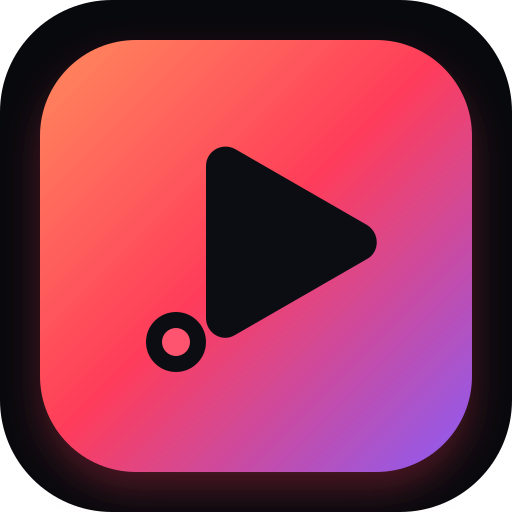
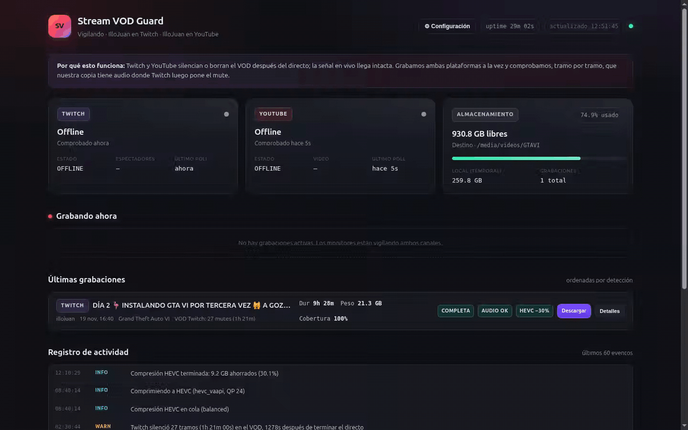
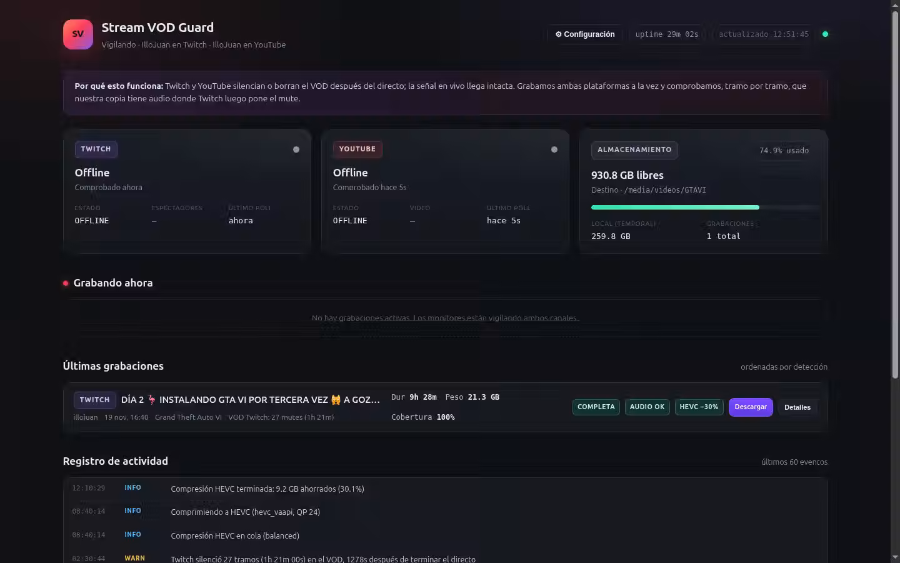
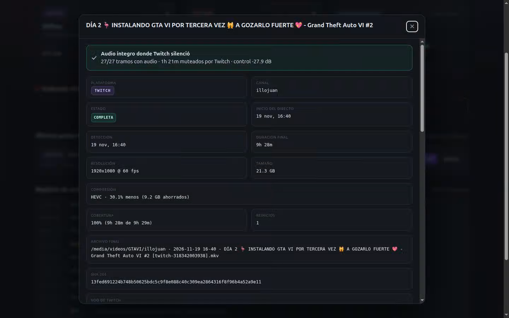
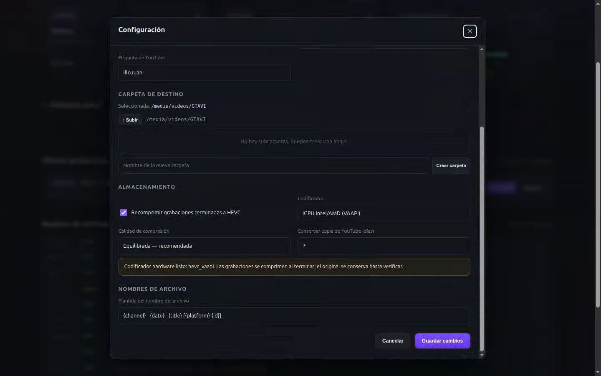

<div align="center">



# Stream VOD Guard

**Archivador autoalojado de directos de Twitch y YouTube, con panel web, selector de carpetas y auditoría de mutes por copyright.**

[](https://github.com/antoniojveram/stream-vod-guard/actions/workflows/ci.yml)
[](LICENSE)
[](docker-compose.yml)
[](https://github.com/antoniojveram/stream-vod-guard/pkgs/container/stream-vod-guard)
[](https://github.com/antoniojveram/stream-vod-guard/releases)

[English](README.md) · [Español](README.es.md) · [Documentación](docs/) · [Caso de estudio](docs/case-study/gta-vi.es.md)

</div>

---

Graba a la vez el directo de **cualquier canal de Twitch y YouTube**, antes de que la plataforma silencie o borre el VOD, y comprueba que el archivo conserva el audio justo en los tramos que Twitch luego mutea.

## Demo

[](assets/demo.es.mp4)

Recorrido mudo de 30 segundos: panel, detalle de una grabación terminada con el
resultado de la compresión HEVC, auditoría de mutes de Twitch y configuración de
almacenamiento/codificador. [Descargar el MP4](assets/demo.es.mp4) · [English demo](README.md#demo)

## Por qué grabar en vivo

- Twitch **no mutea el directo**: escanea el VOD cuando termina la emisión y silencia bloques de audio.
- YouTube **no aplica el claim al archivo hasta que el directo termina**: el directo se emite completo.
- La única copia con el audio original es la **señal en vivo**.

En el caso que originó el proyecto, el VOD de Twitch tenía **12 tramos × 180 s = 36 minutos (11,51 %)** de silencio digital. Los datos están en [docs/case-study/gta-vi.es.md](docs/case-study/gta-vi.es.md).

## Características

- Cualquier canal: Twitch (`login`, `@login`, URL) y YouTube (`UC...`, `@handle`, URL).
- Panel web para canales, carpeta de destino y plantilla de archivo.
- Explorador de carpetas con creación de subcarpetas.
- Captura dual con `streamlink` y `yt-dlp --live-from-start`.
- Watchdog, trozos independientes, recuperación tras reinicio del contenedor.
- Optimizador de almacenamiento: compresión HEVC con la iGPU, fallback x265, selector de codificador y limpieza automática de la copia de YouTube.
- Si no hay codificador compatible, la compresión se omite y el H.264 se conserva intacto.
- MKV final en tu carpeta; trozos temporales en disco local.
- Imagen multi-arquitectura: `linux/amd64` y `linux/arm64`.
- Auditoría de mutes de Twitch con PASS/FAIL por tramo.
- CLI para descargas puntuales, estado, VODs y pruebas.
- Notificaciones opcionales (ntfy, Telegram, Discord).
- Un solo contenedor, sin base de datos.

## Inicio rápido

Requisitos: Docker + Compose v2, ~2 GB de RAM y espacio para las grabaciones (1080p60 ≈ 3,2 GB/h por plataforma; grabando ambas ≈ 5–6 GB/h; la compresión HEVC ahorra típicamente un 30–60 %).

```bash
git clone https://github.com/antoniojveram/stream-vod-guard.git
cd stream-vod-guard

cp .env.example .env
# Edita los canales o déjalos vacíos y usa el panel

mkdir -p videos/recordings
docker compose up -d --build

curl -s http://127.0.0.1:8787/healthz
```

Abre **http://127.0.0.1:8787** y pulsa **⚙ Settings** para configurar los canales y la carpeta.

### NAS o disco externo

Monta la **carpeta padre** que contiene los destinos:

```env
VIDEOS_HOST_PATH=/mnt/nas/videos
VIDEOS_HOST_ROOT=/mnt/nas/videos
RECORDINGS_DIR=/videos/recordings
ARCHIVE_DISPLAY_PATH=/mnt/nas/videos/recordings
```

El panel podrá navegar y crear cualquier subcarpeta dentro de ese padre.

### Imagen publicada

```bash
docker pull ghcr.io/antoniojveram/stream-vod-guard:latest
```

## Panel

| Panel | Detalle | Configuración |
| --- | --- | --- |
|  |  |  |

El panel se llama siempre **Stream VOD Guard**; la identidad del proyecto es fija y no se puede cambiar. Desde **Settings** puedes:

- activar/desactivar Twitch y YouTube;
- cambiar los canales;
- elegir la carpeta de destino y crear carpetas;
- elegir el codificador (**Auto / VAAPI / x265 / None**), la calidad y la retención de la copia de YouTube;
- cambiar la plantilla del archivo.

Los cambios se aplican sin reiniciar. Si cambias de canal con una grabación activa, esa grabación se cierra y se finaliza; la carpeta nueva solo afecta a las nuevas. La configuración del panel se guarda en `data/settings.json` y tiene prioridad sobre `.env`. Las grabaciones terminadas muestran `HEVC −NN %`, el progreso y el ahorro en el historial y en el detalle.

## CLI

```bash
# Estado live
docker compose run --rm stream-vod-guard node src/cli.js status

# Tramos muteados de un VOD de Twitch
docker compose run --rm stream-vod-guard node src/cli.js mutes <vodId>

# Demostrar que el VOD está en silencio digital
docker compose run --rm stream-vod-guard \
  node src/cli.js audit-vod <vodId> --samples

# Descarga puntual
docker compose run --rm stream-vod-guard \
  node src/cli.js record twitch <canal> --output /videos/recordings --duration 60

docker compose run --rm stream-vod-guard \
  node src/cli.js record youtube @canal --output /videos/recordings --duration 0
```

## Cómo funciona

1. Los monitores detectan el directo en Twitch y YouTube.
2. Se graban ambas señales en paralelo, en trozos independientes.
3. Un watchdog reinicia la captura si se queda sin datos.
4. Al terminar, FFmpeg une los trozos en un MKV, verifica los códecs, busca silencios y calcula SHA-256.
5. El MKV se copia a la carpeta elegida; si falla, se conserva en local y se reintenta.
6. Opcionalmente, el MKV se recomprime a HEVC con VAAPI o x265; el original se conserva hasta verificar el nuevo archivo.
7. Opcionalmente, la copia de YouTube se borra a los N días si la de Twitch la cubre.
8. Cuando Twitch escanea el VOD, se comparan sus mutes con nuestra grabación.

Detalle técnico: [docs/architecture.md](docs/architecture.md).

## Estructura de archivos

```
videos/recordings/
  Canal - 2026-11-19 00-15 - Título [twitch-123].mkv
  .stream-vod-guard/<session>/metadata.json
data/
  state.json
  settings.json
  logs/
  work/<session>/raw/
```

## Configuración principal

| Variable | Por defecto | Qué hace |
| --- | --- | --- |
| `TWITCH_CHANNEL` | vacío | Login, `@login` o URL |
| `YOUTUBE_CHANNEL` | vacío | ID, `@handle` o URL |
| `VIDEOS_HOST_PATH` | `./videos` | Carpeta padre montada en `/videos` |
| `VIDEOS_ROOT` / `VIDEOS_HOST_ROOT` | `/videos` / `./videos` | Rutas interna y visible |
| `RECORDINGS_DIR` | `/videos/recordings` | Destino inicial |
| `DATA_HOST_PATH` | `./data` | Estado, logs y trozos |
| `FILENAME_TEMPLATE` | `{channel} - {date} - {title} [{platform}-{id}]` | Nombre final |
| `TWITCH_QUALITY` | `best` | Calidad de Twitch |
| `YOUTUBE_MAX_HEIGHT` | `0` | `0` = máxima calidad; o limita la altura |
| `YOUTUBE_LIVE_FROM_START` | `true` | Recupera desde el inicio del DVR |
| `STALL_TIMEOUT_MS` | `240000` | Umbral del watchdog |
| `MIN_FREE_GB` / `MIN_FREE_ARCHIVE_GB` | `25` / `30` | Protección de disco |
| `CHECKSUM` / `KEEP_RAW` | `true` / `false` | SHA-256 / conservar trozos |
| `COMPRESS_ENABLED` | `false` | Recomprime los MKV terminados a HEVC |
| `COMPRESS_ENCODER` | `auto` | `auto`, `vaapi`, `x265` o `none` |
| `COMPRESS_QUALITY` | `balanced` | `high`, `balanced` o `small` |
| `COMPRESS_BACKFILL_DAYS` | `0` | Al arrancar, comprime las grabaciones de los últimos N días |
| `BACKUP_RETENTION_DAYS` | `0` | Borra la copia de YouTube a los N días; 0 = conservar |
| `VAAPI_DEVICE` | `/dev/dri/renderD128` | Nodo VAAPI para Intel/AMD |
| `RENDER_GID` | `992` | Grupo `render` del host para el override de VAAPI |
| `VOD_AUDIT_ENABLED` | `true` | Auditoría de mutes |
| `RETENTION_DAYS` | `0` | 0 = conservar siempre |
| `DASHBOARD_TOKEN` | vacío | Protege el panel |

Referencia completa: [docs/configuration.md](docs/configuration.md).

### Optimización de almacenamiento

Un directo de 10 h a 1080p60 ocupa unos **32 GB**. Hay dos palancas opcionales
que no bajan la calidad de la captura en vivo:

- **Compresión HEVC** (`COMPRESS_ENABLED=true`): al terminar el directo, el MKV
  se recomprime a HEVC con la iGPU Intel/AMD. En un directo real de 9 h 29 min,
  32,75 GB pasaron a **22,89 GB (30,1 % menos)** con calidad `balanced` en unas
  3,5 h en un Intel N100. El ahorro depende del movimiento; el contenido estático
  puede llegar al 50–60 % o más. El original se conserva hasta verificar el nuevo
  archivo.
- **Retención de la copia de YouTube** (`BACKUP_RETENTION_DAYS=7`): borra la
  copia de YouTube cuando la de Twitch la cubre al menos al 95 %. La de Twitch
  nunca se borra con esta política. `0` conserva ambas para siempre.

Para habilitar la iGPU en un host con `/dev/dri`:

```bash
getent group render                 # normalmente 992
# pon RENDER_GID=992 en .env
docker compose -f docker-compose.yml -f docker-compose.vaapi.yml up -d
```

| `COMPRESS_ENCODER` | Comportamiento |
| --- | --- |
| `auto` | Prueba VAAPI y luego x265; si ninguno funciona, omite la compresión |
| `vaapi` | Exige Intel/AMD VAAPI; si no está, omite la compresión |
| `x265` | Fuerza CPU; compatible pero lento |
| `none` | Desactiva la compresión |

Si no hay GPU compatible, `COMPRESS_ENCODER=auto` cae a **x265 por CPU**. Si
tampoco funciona x265, la compresión se **omite** y el H.264 se conserva intacto:
no se pierde ninguna grabación. El panel permite elegir **Auto / VAAPI / CPU /
None**, muestra el codificador detectado y permite cambiar de modo sin editar
`.env`.

La imagen se publica para **linux/amd64 y linux/arm64**; el override de VAAPI es
opcional. Guía completa: [docs/storage.md](docs/storage.md).

## Varios canales

Una instancia por canal, cada una con su `.env`, puerto, datos y destino:

```bash
cp .env .env.second
# edita CONTAINER_NAME, DASHBOARD_PORT, DATA_HOST_PATH, RECORDINGS_DIR y canales
APP_ENV_FILE=.env.second docker compose -p second --env-file .env.second up -d
```

## Solución de problemas

| Síntoma | Solución |
| --- | --- |
| Canal desactivado | Configúralo en Settings o `.env`; Twitch acepta URL/@, YouTube ID/handle/URL. |
| YouTube no graba | Puede ser solo para miembros: configura `YT_COOKIES_FILE`; revisa logs. |
| Destino no escribible | Revisa permisos de `VIDEOS_HOST_PATH` y el montaje del NAS. Los archivos quedan en local y se reintentan. |
| Huecos en Twitch | Filtrado de anuncios; usa la copia de YouTube o pon `TWITCH_DISABLE_ADS=false`. |
| Auditoría pendiente | Twitch aún no ha escaneado el VOD o es solo-subs/borrado. La grabación sigue siendo válida. |
| La compresión dice "no encoder" | En **Configuración → Almacenamiento**, elige **Auto** o **CPU (x265)**, o pasa `/dev/dri` con `docker-compose.vaapi.yml`. El H.264 se conserva igualmente. |
| La compresión tarda mucho | VAAPI no está activo y x265 usa la CPU. Revisa el codificador detectado en **Configuración → Almacenamiento** y la [guía de almacenamiento](docs/storage.md). |
| Puerto ocupado | Cambia `DASHBOARD_PORT`. |

Más: [docs/troubleshooting.md](docs/troubleshooting.md).

## Seguridad y uso responsable

Herramienta para **uso personal**: graba directos públicos para verlos en diferido. No redistribuyas las grabaciones, no eludas controles de acceso y respeta la voluntad del streamer, las condiciones de Twitch/YouTube y los derechos de la música. Ver [SECURITY.md](SECURITY.md) y [docs/security.md](docs/security.md).

## Contribuir

Lee [CONTRIBUTING.md](CONTRIBUTING.md) y [CODE_OF_CONDUCT.md](CODE_OF_CONDUCT.md). Las issues y PRs son bienvenidos.

`main` está protegida: no se puede hacer push directo, force push ni borrar la
rama, CI debe pasar y el code owner debe aprobar cada PR. Los colaboradores de
confianza con rol **Write** pueden crear una rama en este repositorio y abrir un
PR; los contribuyentes externos pueden hacer fork y abrir un PR sin permisos de
escritura. Los tags de release (`v*`) solo los puede crear el propietario.

## Licencia

[MIT](LICENSE) © 2026 antoniojveram y colaboradores.
