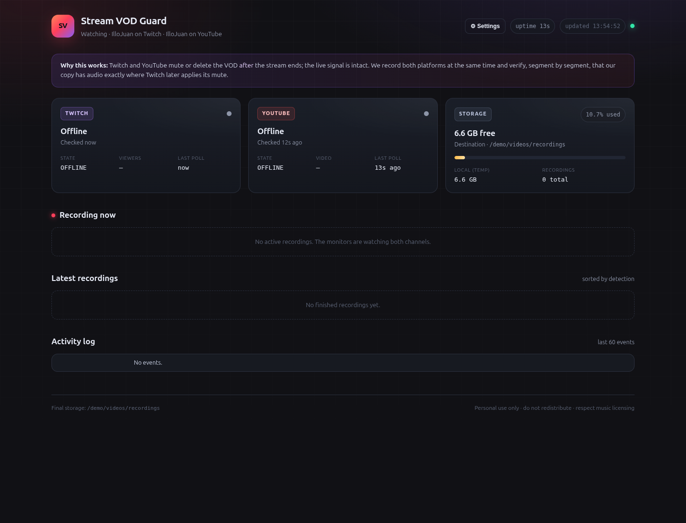
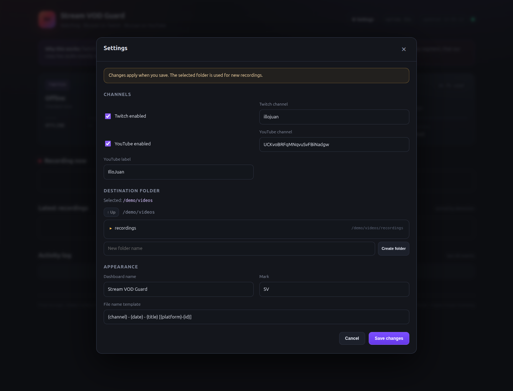

<div align="center">


# Stream VOD Guard

**Archivador autoalojado de directos de Twitch y YouTube, con panel web, selector de carpetas y auditoría de mutes por copyright.**

[](https://github.com/antoniojveram/stream-vod-guard/actions/workflows/ci.yml)
[](LICENSE)
[](docker-compose.yml)

[English](README.md) · [Español](README.es.md) · [Documentación](docs/) · [Caso de estudio](docs/case-study/gta-vi.md)

</div>

---

Graba a la vez el directo de **cualquier canal de Twitch y YouTube**, antes de que la plataforma silencie o borre el VOD, y comprueba que el archivo conserva el audio justo en los tramos que Twitch luego mutea.



## Por qué grabar en vivo

- Twitch **no mutea el directo**: escanea el VOD cuando termina la emisión y silencia bloques de audio.
- YouTube **no aplica el claim al archivo hasta que el directo termina**: el directo se emite completo.
- La única copia con el audio original es la **señal en vivo**.

En el caso que originó el proyecto, el VOD de Twitch tenía **12 tramos × 180 s = 36 minutos (11,51 %)** de silencio digital. Los datos están en [docs/case-study/gta-vi.md](docs/case-study/gta-vi.md).

## Características

- Cualquier canal: Twitch (`login`, `@login`, URL) y YouTube (`UC...`, `@handle`, URL).
- Panel web para canales, carpeta de destino, nombre, marca y plantilla de archivo.
- Explorador de carpetas con creación de subcarpetas.
- Captura dual con `streamlink` y `yt-dlp --live-from-start`.
- Watchdog, trozos independientes, recuperación tras reinicio del contenedor.
- MKV final en tu carpeta; trozos temporales en disco local.
- Auditoría de mutes de Twitch con PASS/FAIL por tramo.
- CLI para descargas puntuales, estado, VODs y pruebas.
- Notificaciones opcionales (ntfy, Telegram, Discord).
- Un solo contenedor, sin base de datos.

## Inicio rápido

Requisitos: Docker + Compose v2, ~2 GB de RAM y espacio para las grabaciones (1080p60 ≈ 3,5 GB/h por plataforma).

```bash
git clone https://github.com/antoniojveram/stream-vod-guard.git
cd stream-vod-guard

cp .env.example .env
# Edita los canales o déjalos vacíos y usa el panel

mkdir -p videos/recordings
docker compose up -d --build

curl -s http://127.0.0.1:8787/healthz
```

Abre **http://127.0.0.1:8787** y pulsa **⚙ Settings** para configurar los canales y la carpeta.

### NAS o disco externo

Monta la **carpeta padre** que contiene los destinos:

```env
VIDEOS_HOST_PATH=/mnt/nas/videos
VIDEOS_HOST_ROOT=/mnt/nas/videos
RECORDINGS_DIR=/videos/recordings
ARCHIVE_DISPLAY_PATH=/mnt/nas/videos/recordings
```

El panel podrá navegar y crear cualquier subcarpeta dentro de ese padre.

### Imagen publicada

```bash
docker pull ghcr.io/antoniojveram/stream-vod-guard:latest
```

## Panel



Desde **Settings** puedes:

- activar/desactivar Twitch y YouTube;
- cambiar los canales;
- elegir la carpeta de destino y crear carpetas;
- cambiar el nombre del panel, la marca y la plantilla del archivo.

Los cambios se aplican sin reiniciar. Si cambias de canal con una grabación activa, esa grabación se cierra y se finaliza; la carpeta nueva solo afecta a las nuevas. La configuración del panel se guarda en `data/settings.json` y tiene prioridad sobre `.env`.

## CLI

```bash
# Estado live
docker compose run --rm stream-vod-guard node src/cli.js status

# Tramos muteados de un VOD de Twitch
docker compose run --rm stream-vod-guard node src/cli.js mutes <vodId>

# Demostrar que el VOD está en silencio digital
docker compose run --rm stream-vod-guard \
  node src/cli.js audit-vod <vodId> --samples

# Descarga puntual
docker compose run --rm stream-vod-guard \
  node src/cli.js record twitch <canal> --output /videos/recordings --duration 60

docker compose run --rm stream-vod-guard \
  node src/cli.js record youtube @canal --output /videos/recordings --duration 0
```

## Cómo funciona

1. Los monitores detectan el directo en Twitch y YouTube.
2. Se graban ambas señales en paralelo, en trozos independientes.
3. Un watchdog reinicia la captura si se queda sin datos.
4. Al terminar, FFmpeg une los trozos en un MKV, verifica los códecs, busca silencios y calcula SHA-256.
5. El MKV se copia a la carpeta elegida; si falla, se conserva en local y se reintenta.
6. Cuando Twitch escanea el VOD, se comparan sus mutes con nuestra grabación.

Detalle técnico: [docs/architecture.md](docs/architecture.md).

## Estructura de archivos

```
videos/recordings/
  Canal - 2026-11-19 00-15 - Título [twitch-123].mkv
  .stream-vod-guard/<session>/metadata.json
data/
  state.json
  settings.json
  logs/
  work/<session>/raw/
```

## Configuración principal

| Variable | Por defecto | Qué hace |
| --- | --- | --- |
| `APP_NAME` / `APP_MARK` | `Stream VOD Guard` / `SV` | Identidad del panel |
| `TWITCH_CHANNEL` | vacío | Login, `@login` o URL |
| `YOUTUBE_CHANNEL` | vacío | ID, `@handle` o URL |
| `VIDEOS_HOST_PATH` | `./videos` | Carpeta padre montada en `/videos` |
| `VIDEOS_ROOT` / `VIDEOS_HOST_ROOT` | `/videos` / `./videos` | Rutas interna y visible |
| `RECORDINGS_DIR` | `/videos/recordings` | Destino inicial |
| `DATA_HOST_PATH` | `./data` | Estado, logs y trozos |
| `FILENAME_TEMPLATE` | `{channel} - {date} - {title} [{platform}-{id}]` | Nombre final |
| `TWITCH_QUALITY` | `best` | Calidad de Twitch |
| `YOUTUBE_MAX_HEIGHT` | `1080` | Altura máxima de YouTube |
| `YOUTUBE_LIVE_FROM_START` | `true` | Recupera desde el inicio del DVR |
| `STALL_TIMEOUT_MS` | `240000` | Umbral del watchdog |
| `MIN_FREE_GB` / `MIN_FREE_ARCHIVE_GB` | `25` / `30` | Protección de disco |
| `CHECKSUM` / `KEEP_RAW` | `true` / `false` | SHA-256 / conservar trozos |
| `VOD_AUDIT_ENABLED` | `true` | Auditoría de mutes |
| `RETENTION_DAYS` | `0` | 0 = conservar siempre |
| `DASHBOARD_TOKEN` | vacío | Protege el panel |

Referencia completa: [docs/configuration.md](docs/configuration.md).

## Varios canales

Una instancia por canal, cada una con su `.env`, puerto, datos y destino:

```bash
cp .env .env.second
# edita CONTAINER_NAME, DASHBOARD_PORT, DATA_HOST_PATH, RECORDINGS_DIR y canales
APP_ENV_FILE=.env.second docker compose -p second --env-file .env.second up -d
```

## Solución de problemas

| Síntoma | Solución |
| --- | --- |
| Canal desactivado | Configúralo en Settings o `.env`; Twitch acepta URL/@, YouTube ID/handle/URL. |
| YouTube no graba | Puede ser solo para miembros: configura `YT_COOKIES_FILE`; revisa logs. |
| Destino no escribible | Revisa permisos de `VIDEOS_HOST_PATH` y el montaje del NAS. Los archivos quedan en local y se reintentan. |
| Huecos en Twitch | Filtrado de anuncios; usa la copia de YouTube o pon `TWITCH_DISABLE_ADS=false`. |
| Auditoría pendiente | Twitch aún no ha escaneado el VOD o es solo-subs/borrado. La grabación sigue siendo válida. |
| Puerto ocupado | Cambia `DASHBOARD_PORT`. |

Más: [docs/troubleshooting.md](docs/troubleshooting.md).

## Seguridad y uso responsable

Herramienta para **uso personal**: graba directos públicos para verlos en diferido. No redistribuyas las grabaciones, no eludas controles de acceso y respeta la voluntad del streamer, las condiciones de Twitch/YouTube y los derechos de la música. Ver [SECURITY.md](SECURITY.md) y [docs/security.md](docs/security.md).

## Contribuir

Lee [CONTRIBUTING.md](CONTRIBUTING.md) y [CODE_OF_CONDUCT.md](CODE_OF_CONDUCT.md). Las issues y PRs son bienvenidos.

## Licencia

[MIT](LICENSE) © 2026 antoniojveram y colaboradores.
