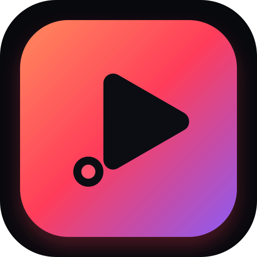
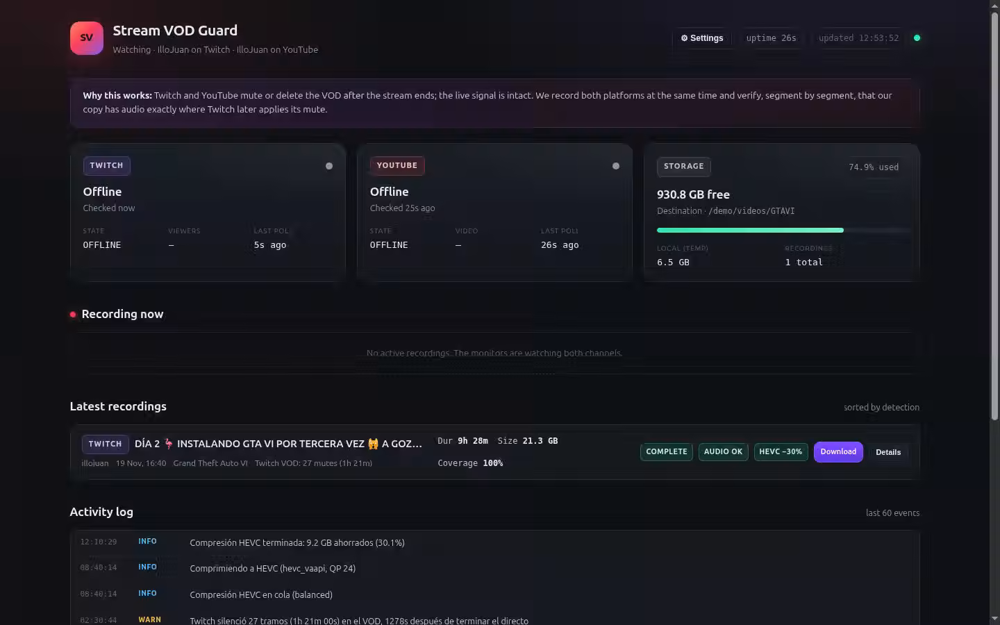
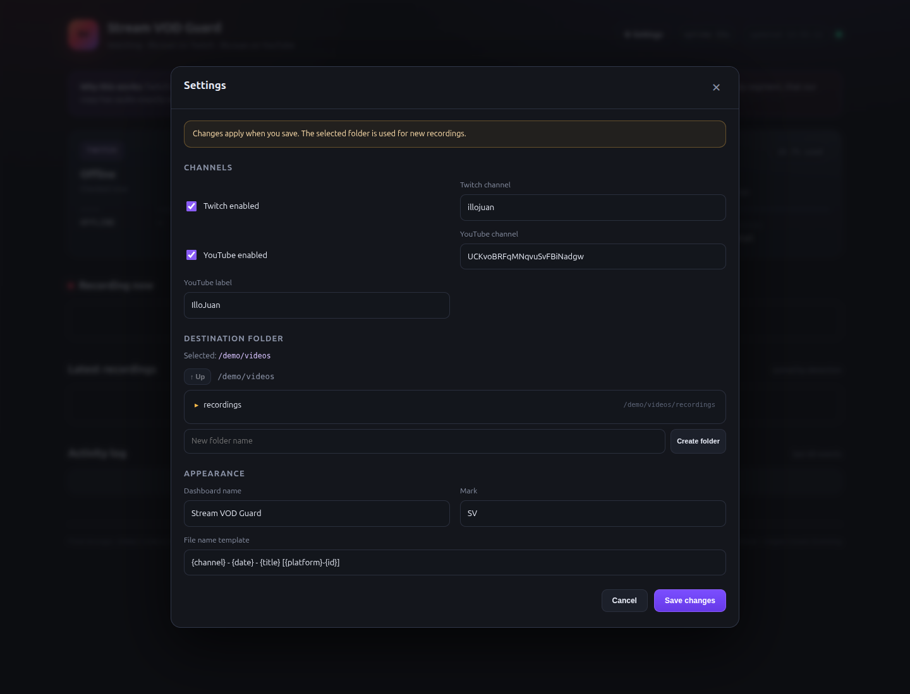
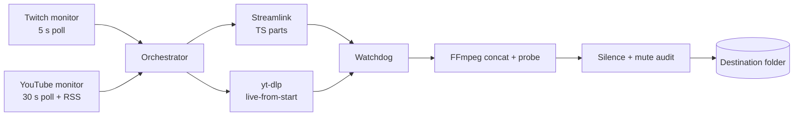

<div align="center">



# Stream VOD Guard

**Self-hosted live stream archiver for Twitch and YouTube — with a web UI, folder picker and copyright-mute audit.**

[](https://github.com/antoniojveram/stream-vod-guard/actions/workflows/ci.yml)
[](LICENSE)
[](docker-compose.yml)
[](https://github.com/antoniojveram/stream-vod-guard/pkgs/container/stream-vod-guard)

[English](README.md) · [Español](README.es.md) · [Docs](docs/) · [Case study](docs/case-study/gta-vi.md)

</div>

---

Stream VOD Guard records a creator's **live** Twitch and YouTube streams at the same time, then verifies that the archive still contains audio in the exact segments Twitch later silences on the VOD. It is designed for personal time-shifting and archiving of publicly available streams.

It is not tied to any channel or game: pick any Twitch login and any YouTube channel, and choose the destination folder from the dashboard.



## Why record live?

- **Twitch does not mute the live broadcast.** It scans the stored VOD after the stream ends and silences blocks of copyright-detected audio.
- **YouTube only applies Content ID claims to the archive after the stream ends.** The archive can be muted, blocked or deleted; the live signal was already complete.
- The only copy that is guaranteed to contain the original audio is the **live feed**.

In the case study that motivated this project, the Twitch VOD had **12 muted segments × 180 seconds = 36 minutes (11.51%)** of digital silence, while the live signal was intact. See [docs/case-study/gta-vi.md](docs/case-study/gta-vi.md) for the raw data.

Stream VOD Guard therefore captures **both live feeds in parallel**, so one platform's ads, outages or post-stream processing cannot destroy the recording.

## Features

- **Any channel**: Twitch login, `@login` or URL; YouTube channel ID, `@handle` or URL.
- **Web UI**: edit channels, destination folder, app name, mark and filename template without editing files.
- **Folder picker**: browse a mounted parent folder, create subfolders, change destination on the fly.
- **Dual capture**: Twitch via `streamlink`, YouTube via `yt-dlp --live-from-start`.
- **Crash resilient**: rolling parts, watchdog restarts, container-restart recovery.
- **Storage-safe**: raw chunks on local disk, final MKV copied to your destination; retries if the destination is unavailable.
- **Storage optimizer**: optional HEVC compression with the Intel/AMD iGPU and automatic pruning of the YouTube backup.
- **Mute audit**: compares its own file with Twitch's `muted_segments` and reports PASS/FAIL per segment.
- **Single container**: no database, no external services. FFmpeg, Streamlink and yt-dlp included.
- **CLI**: one-off captures, live status, VOD mute inspection, file probing.
- **Notifications**: ntfy, Telegram and Discord (optional).
- **Retention, disk guards, checksums, range downloads, optional dashboard token.**

## Quick start

Requirements:

- Docker Engine 24+ and Docker Compose v2
- ~2 GB RAM and enough disk for your recordings (~3.5 GB per hour at 1080p60, ~7 GB/h recording both platforms)
- Linux is recommended for bind mounts and permissions

```bash
git clone https://github.com/antoniojveram/stream-vod-guard.git
cd stream-vod-guard

cp .env.example .env
# Option A: edit .env with your channels
# Option B: leave channels empty, start the stack and use the Settings dialog

mkdir -p videos/recordings
docker compose up -d --build

curl -s http://127.0.0.1:8787/healthz
```

Open **http://127.0.0.1:8787** and press **⚙ Settings** to set the channels and destination.

> If both channels are empty, the monitors stay disabled and the dashboard explains what to do. Nothing crashes.

### Using a NAS or external disk

Mount the **parent folder** that contains your destinations:

```env
VIDEOS_HOST_PATH=/mnt/nas/videos
VIDEOS_HOST_ROOT=/mnt/nas/videos
RECORDINGS_DIR=/videos/recordings
ARCHIVE_DISPLAY_PATH=/mnt/nas/videos/recordings
```

The dashboard can then browse and create any subfolder under `/mnt/nas/videos`. Change the parent and restart once; selecting subfolders afterwards needs no restart.

### Prebuilt image

A multi-arch image is published to GHCR on every release:

```bash
docker pull ghcr.io/antoniojveram/stream-vod-guard:latest
```

`docker-compose.yml` uses it as the default image and also supports local builds. Use `docker compose up -d --build` to build from source.

## Web UI

| Dashboard | Settings |
| --- | --- |
|  |  |

The Settings dialog lets you:

- enable/disable Twitch and YouTube;
- change channels (ID, handle or URL);
- browse the mounted parent folder and create a destination;
- rename the dashboard, change its mark and the filename template.

Changes apply **without restarting**. Channel changes finalize any active recording on that platform; destination changes only affect new recordings. Settings are persisted in `data/settings.json` and take precedence over `.env`.

## CLI

```bash
# Live status
docker compose run --rm stream-vod-guard node src/cli.js status

# Twitch VOD muted segments
docker compose run --rm stream-vod-guard node src/cli.js mutes <vodId>

# Prove whether a VOD is digitally silent
docker compose run --rm stream-vod-guard \
  node src/cli.js audit-vod <vodId> --samples

# One-off capture (no 24/7 service)
docker compose run --rm stream-vod-guard \
  node src/cli.js record twitch <channel> --output /videos/recordings --duration 60

docker compose run --rm stream-vod-guard \
  node src/cli.js record youtube @channel --output /videos/recordings --duration 0
```

More in [docs/cli.md](docs/cli.md).

## How it works



- **Monitors** detect live state and create a session.
- **Capture** writes one file per attempt; a stalled/failed process is killed and restarted.
- **Finalize** normalizes parts, concatenates into MKV, probes streams, scans long silences and computes SHA-256.
- **Archive** copies the final file to the session's destination; local copies are kept until the copy succeeds.
- **Audit** fetches Twitch's muted segments after the VOD is processed and samples the recording in each muted range.

Detailed design: [docs/architecture.md](docs/architecture.md).

## Storage layout

```
videos/recordings/                                  # your destination
  Channel - 2026-11-19 00-15 - Title [twitch-123].mkv
  .stream-vod-guard/<session-id>/metadata.json
data/
  state.json
  settings.json
  logs/
  work/<session-id>/raw/                            # temporary parts
  work/<session-id>/final/                          # local final before copy
```

Each session snapshots its destination when it starts, so changing the destination in the UI never moves an in-flight recording.

## Mute audit

When Twitch finishes scanning the VOD, Stream VOD Guard:

1. finds the VOD by stream start time;
2. reads its public `muted_segments`;
3. samples 30 s in the middle of each muted segment from **our** recording;
4. measures volume with `ffmpeg volumedetect`;
5. reports `PASS` (audio present), `WARN` (low), `FAIL` (digital silence) or `OUTSIDE` (recording started late).

Case study output:

```
Twitch VOD: 12 segments (36m) muted
Our copy:   12/12 with audio
Control:    -31.1 dB
Muted:      -91 dB (in the Twitch VOD)
```

The dashboard shows the per-segment table and stores it in `metadata.json`.

## Configuration

Everything is configurable through `.env` and the dashboard. Main variables:

| Variable | Default | Description |
| --- | --- | --- |
| `APP_NAME` / `APP_MARK` | `Stream VOD Guard` / `SV` | Dashboard identity |
| `TWITCH_CHANNEL` | empty | Login, `@login` or URL |
| `YOUTUBE_CHANNEL` | empty | ID, `@handle` or URL |
| `YOUTUBE_CHANNEL_LABEL` | resolved | Display name |
| `VIDEOS_HOST_PATH` | `./videos` | Host parent mounted at `/videos` |
| `VIDEOS_ROOT` / `VIDEOS_HOST_ROOT` | `/videos` / `./videos` | Container and display paths |
| `RECORDINGS_DIR` | `/videos/recordings` | Initial destination |
| `DATA_HOST_PATH` | `./data` | State, logs, temporary parts |
| `FILENAME_TEMPLATE` | `{channel} - {date} - {title} [{platform}-{id}]` | Final name |
| `TWITCH_QUALITY` | `best` | Streamlink quality |
| `YOUTUBE_MAX_HEIGHT` | `0` | `0` = maximum available; or cap height (720, 1080…) |
| `YOUTUBE_LIVE_FROM_START` | `true` | Recover from DVR start |
| `STALL_TIMEOUT_MS` | `240000` | Watchdog threshold |
| `OFFLINE_GRACE_MS` | `90000` | Wait before finalizing |
| `MIN_FREE_GB` / `MIN_FREE_ARCHIVE_GB` | `25` / `30` | Disk guards |
| `CHECKSUM` / `KEEP_RAW` | `true` / `false` | SHA-256 / keep parts |
| `COMPRESS_ENABLED` | `false` | Re-encode finished MKVs to HEVC |
| `COMPRESS_QUALITY` | `balanced` | `high`, `balanced` or `small` |
| `BACKUP_RETENTION_DAYS` | `0` | Delete the YouTube backup after N days; 0 = keep |
| `VOD_AUDIT_ENABLED` | `true` | Twitch mute audit |
| `RETENTION_DAYS` | `0` | 0 = keep forever |
| `DASHBOARD_TOKEN` | empty | Protect the dashboard |

### Maximum quality

The defaults are set to capture the best rendition each platform offers:

- Twitch: `TWITCH_QUALITY=best` (source quality, generally 1080p60).
- YouTube: `YOUTUBE_MAX_HEIGHT=0` selects the best video + best audio available (up to 4K/60 if the stream provides it).

The final MKV is a **remux** (`-c copy`); there is no re-encode. The dashboard detail shows the real resolution and FPS of the finished file. Set `YOUTUBE_MAX_HEIGHT=1080` (or `720`) only if you want to trade quality for disk space.

Full reference: [docs/configuration.md](docs/configuration.md) · [quality guarantees](docs/quality.md).

### Storage optimization

A 10-hour 1080p60 stream is about **32 GB**. Two optional mechanisms reduce the
archive without lowering the live capture quality:

- **HEVC compression** (`COMPRESS_ENABLED=true`): after the stream ends, the MKV
  is re-encoded to HEVC with the Intel/AMD iGPU. Expect **40–60% smaller files**
  at `balanced` quality and roughly **4–6 hours per 10-hour stream** on an Intel
  N100. The original is kept until the new file is probed, decoded and verified.
- **YouTube backup retention** (`BACKUP_RETENTION_DAYS=7`): deletes the YouTube
  copy after a verified Twitch recording covers at least 95% of it. The Twitch
  file is never deleted by this policy. `0` keeps both forever.

Enable the iGPU passthrough on a host with `/dev/dri`:

```bash
getent group render                 # usually 992
# set RENDER_GID=992 in .env
docker compose -f docker-compose.yml -f docker-compose.vaapi.yml up -d
```

If no compatible GPU is available, `COMPRESS_ENCODER=auto` falls back to **x265
on the CPU**. If neither VAAPI nor x265 works, compression is **skipped** and the
H.264 file is kept untouched — no recording is lost. The dashboard lets you
choose **Auto / VAAPI / CPU / None** and shows the detected encoder.

The image is published for **linux/amd64 and linux/arm64**; the VAAPI override is
optional. Full guide: [docs/storage.md](docs/storage.md).

### Several channels

Run one container per channel with its own `.env`, port, data folder and destination:

```bash
cp .env .env.second
# edit CONTAINER_NAME, DASHBOARD_PORT, DATA_HOST_PATH, RECORDINGS_DIR, channels
APP_ENV_FILE=.env.second docker compose -p second --env-file .env.second up -d
```

The dashboard folder picker can share the same parent mount across instances.

## Production notes

- **Keep the host awake** and Docker enabled at boot (`restart: unless-stopped`).
- **Localhost only by default.** Put a reverse proxy with authentication in front if you expose it. `DASHBOARD_TOKEN` adds a simple bearer/query token.
- **Disk sizing.** 1080p60 ≈ 3.2 GB/h per platform. Record both ≈ 5–6 GB/h. With HEVC compression the archive drops to ≈ 1.3–1.9 GB/h. The system warns and stops before filling local disk.
- **Twitch ads.** `TWITCH_DISABLE_ADS=true` filters ad segments (leaving small gaps). The YouTube copy covers those gaps; both files are kept.
- **YouTube members-only streams** need cookies: set `YT_COOKIES_FILE` to a Netscape-format cookies file.
- **Keep yt-dlp current.** Rebuild the image periodically (`docker compose build --pull`); YouTube changes often.
- **Updates:** `docker compose pull && docker compose up -d` or `docker compose up -d --build`.

## Troubleshooting

| Symptom | Fix |
| --- | --- |
| Dashboard says channel disabled | Set the channel in Settings or `.env`; Twitch accepts URLs and `@`, YouTube accepts IDs, handles and URLs. |
| YouTube monitor errors | The channel may be members-only or the handle is wrong. Check logs and `YOUTUBE_CHANNEL_LABEL`. |
| Destination not writable | Check `VIDEOS_HOST_PATH` permissions and that the NAS is mounted. Files stay local and are retried. |
| Twitch has gaps | Ad filtering. Use the YouTube copy or set `TWITCH_DISABLE_ADS=false`. |
| Audit stays pending | Twitch has not scanned the VOD yet, or the VOD is sub-only/deleted. The recording is still valid. |
| Port already in use | Change `DASHBOARD_PORT`. |

More: [docs/troubleshooting.md](docs/troubleshooting.md).

## Development

```bash
# Local unit tests
node --test test/unit.test.js

# Build the image and run tests inside it
docker compose build
docker compose run --rm --entrypoint node stream-vod-guard --test test/unit.test.js
docker compose run --rm -e E2E=1 --entrypoint node stream-vod-guard \
  --test test/audit.test.js test/e2e.test.js test/integration.test.js
```

Architecture and conventions: [docs/development.md](docs/development.md).

## Security and legal

This tool records **public live streams for personal use**. Do not redistribute recordings, do not bypass access controls, and respect the streamer's wishes, Twitch/YouTube terms and the rights of music copyright holders. See [SECURITY.md](SECURITY.md) and [docs/security.md](docs/security.md).

## Contributing

Issues and pull requests are welcome. Please read [CONTRIBUTING.md](CONTRIBUTING.md) and [CODE_OF_CONDUCT.md](CODE_OF_CONDUCT.md).

## License

[MIT](LICENSE) © 2026 antoniojveram and contributors.
