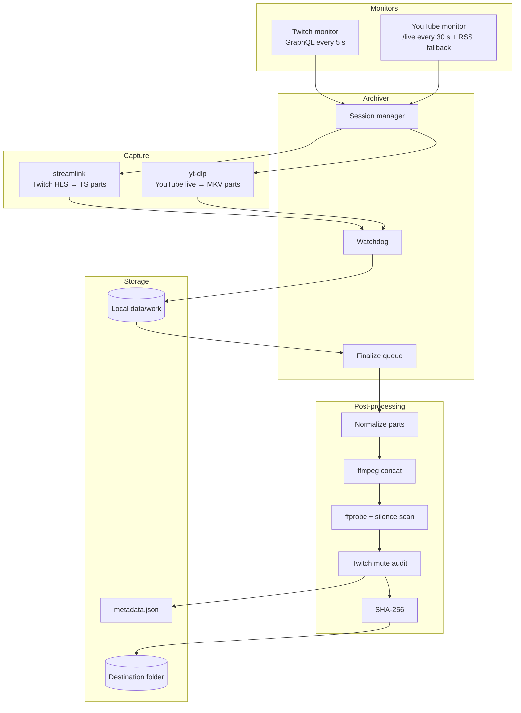

# Architecture

Stream VOD Guard is a single Node.js process inside one container. It uses FFmpeg, Streamlink and yt-dlp as child processes and keeps its state in JSON files.

## Components



| Module | Responsibility |
| --- | --- |
| `src/index.js` | Startup, tool checks, channel resolution, HTTP server, signals |
| `src/monitor.js` | Live polling, session lifecycle, watchdog, finalize queue, VOD audit watcher |
| `src/recorder.js` | Child process management, part files, process-group kill, restarts |
| `src/postprocess.js` | Part normalization, concat, probe, silence scan, mute audit, archive |
| `src/settings.js` | Persisted UI settings, destination validation, display mapping |
| `src/twitch.js` | Public GraphQL: live state, VODs, muted segments |
| `src/youtube.js` | `/live` parsing, channel resolution, RSS, yt-dlp metadata |
| `src/api.js` | Dashboard, REST API, folder browser, range downloads |
| `src/store.js` | Atomic JSON state, sessions, events |
| `src/cli.js` | One-off commands |

## Session lifecycle

```mermaid
stateDiagram-v2
  [*] --> recording: live detected
  recording --> ending: offline grace / channel change
  ending --> finalizing: capture stopped
  finalizing --> archived-pending: local MKV ready
  archived-pending --> done: copy to destination OK
  finalizing --> failed: no usable parts / concat error
  archived-pending --> archived-pending: copy failed, retried
```

- A session is identified by `twitch-<streamId>` or `youtube-<videoId>`. If the same live returns after a manual finalize or a long disconnect, a `-r2` suffix creates a new session instead of reusing a completed one.
- The destination is **snapshotted at session start**. Changing the destination in the UI affects new sessions only.
- Each attempt writes a new part: `part-0001.ts`, `part-0002.ts`, etc. Existing parts are never overwritten.

## Capture and watchdog

- Twitch: `streamlink --twitch-disable-ads -o part.ts best`.
- YouTube: `yt-dlp --live-from-start -f "bv*[height<=1080]+ba/b" --merge-output-format mkv`.
- Children run in a separate **process group**. Killing a capture kills yt-dlp and its ffmpeg grandchildren; otherwise a surviving ffmpeg can hold the stdout pipe and prevent restart.
- The watchdog checks the part size every 10 s. No growth for 4 minutes (longer than a Twitch ad break) kills the group and restarts with exponential backoff.
- On container start, `recover()` reconciles part files from disk. If the stream is still live it resumes; otherwise it finalizes.

## Finalization

1. Normalize each part:
   - Twitch: select the best `.ts` file.
   - YouTube: use the merged MKV, or mux the separate video/audio fragments when the process was killed.
2. `ffmpeg -f concat -c copy` into `data/work/<session>/final/final.mkv`.
3. `ffprobe`: codecs, duration, audio presence.
4. `silencedetect`: long silences, useful to spot capture gaps.
5. Optional SHA-256.
6. Copy to `session.destinationDir` with `copyFileVerified` (size check).
7. Write `.stream-vod-guard/<session>/metadata.json`.
8. Delete local raw/final parts unless `KEEP_RAW=true`.

If the destination copy fails, the status becomes `archived-pending`; `retryPendingArchives()` retries every minute and on startup. Local files are never deleted before a verified copy.

## Twitch mute audit

Twitch's public VOD seekbar uses the `VideoPlayer_VODSeekbar` GraphQL operation. It returns `muteInfo.mutedSegmentConnection.nodes` with `offset` and `duration` (seconds).

After the stream ends, a background watcher:

1. Finds the VOD by broadcast start time.
2. Polls its muted segments for up to 24 h.
3. For each segment, samples 30 s at the offset midpoint from our recording.
4. Measures volume with FFmpeg `volumedetect`.
5. Classifies: `pass` (> -55 dB), `warn` (-90…-55 dB), `fail` (≤ -90 dB), `outside-coverage`.

Alignment uses `recordingStartedAt - streamStartedAt`; sampling the middle of a 3-minute block tolerates a few seconds of drift. If the recording started after the segment, it is marked outside coverage instead of falsely passing.

## Failure handling

| Failure | Behaviour |
| --- | --- |
| Capture process crash | Process group killed, new part, restart with backoff |
| Container restart | Parts reconciled, session resumed or finalized |
| Destination unavailable | Final kept local, retried; disk guard protects local disk |
| YouTube members-only | Capture fails; Twitch keeps recording; cookies can fix it |
| Twitch ad break | Watchdog threshold is larger than an ad break; gaps are covered by YouTube |
| Twitch VOD deleted/sub-only | Audit stays pending; recording remains valid |
| Channel changed in UI | Monitors restart; active sessions for that platform are finalized |

## Security boundaries

- Dashboard binds to `127.0.0.1` by default; optional token.
- Destination paths are constrained to `VIDEOS_ROOT`; hidden metadata directories are not downloadable.
- The container drops all Linux capabilities and sets `no-new-privileges`.
- Raw parts are local; the dashboard serves only files under the mounted videos root.
